<!-- ================================================================== -->
<!--                        ElGundamPa // README                         -->
<!-- ================================================================== -->

<div align="center">




<a href="https://github.com/ElGundamPa"></a>
<a href="https://instagram.com/gundamsb"></a>


</div>


<div align="center">
  
</div>


### `> cat /etc/gundam.conf`

```yaml
user:        Gundam (ElGundamPa)
pronouns:    he/him
role:        Full Stack Developer // Offensive Security
dev:         [ web apps, APIs, iOS apps, dashboards, automation ]
security:    [ pentesting, web app security, network security, red team tooling ]
approach:    secure-by-design — I build it, then I try to break it
currently:   building rootfury, netguard, shinra & byframe
learning:    [ exploit development, cloud security, system design ]
motto:       "Ship fast. Ship secure."
```


### `> ls ~/arsenal/`

<details open>
<summary><b>🎨 Frontend</b></summary>
<br>


</details>

<details open>
<summary><b>🧠 Backend & APIs</b></summary>
<br>


</details>

<details open>
<summary><b>🗄️ Databases</b></summary>
<br>


</details>

<details open>
<summary><b>🗡️ Offensive / Pentesting</b></summary>
<br>


</details>

<details open>
<summary><b>🛡️ Network / Defensive / Reversing</b></summary>
<br>


</details>

<details open>
<summary><b>💻 Languages</b></summary>
<br>


</details>

<details open>
<summary><b>☁️ DevOps / Cloud / Tools</b></summary>
<br>


</details>

<details open>
<summary><b>🏴 Training Grounds</b></summary>
<br>


</details>


### `> ./projects --list`

| Proyecto | Descripción | Stack | Acceso |
|---|---|---|---|
| 🔥 **rootfury** | _Describe aquí rootfury (ej. framework de post-explotación / privesc)_ | `TypeScript` | 🔒 Privado |
| 🛡️ **netguard** | _Describe aquí netguard (ej. monitor / escáner de red)_ | `Python` | 🔒 Privado |
| ⚡ **shinra** | _Describe aquí shinra_ | `Python` | 🔒 Privado |
| 🖥️ **Terminal** | _Describe aquí Terminal_ | `Swift` | 🔒 Privado |
| 🧩 **[byframe](https://github.com/ElGundamPa/byframe)** | _Describe aquí byframe (app web full stack)_ | `TypeScript` | 🌐 Público |
| 📚 **[oturukistpedia](https://github.com/ElGundamPa/oturukistpedia)** | _Describe aquí oturukistpedia_ | `TypeScript` | 🌐 Público |

<div align="center">

```diff
- [ACCESS RESTRICTED] La mayoría de mis repositorios son privados.
+ ¿Quieres ver el código o colaborar? Contáctame y te doy acceso.
```

<a href="https://instagram.com/gundamsb"></a>

</div>


### `> netstat --stats`

<div align="center">


</div>


### `> tail -f /var/log/contributions.log`

<div align="center">
<picture>
  <source media="(prefers-color-scheme: dark)" srcset="https://raw.githubusercontent.com/ElGundamPa/ElGundamPa/output/snake-dark.svg" />
  
</picture>
</div>


<div align="center">

```diff
- [!] Todo lo publicado aquí es con fines educativos y de hacking ético.
+ [✓] Solo pruebo sistemas con autorización explícita.
```


</div>
